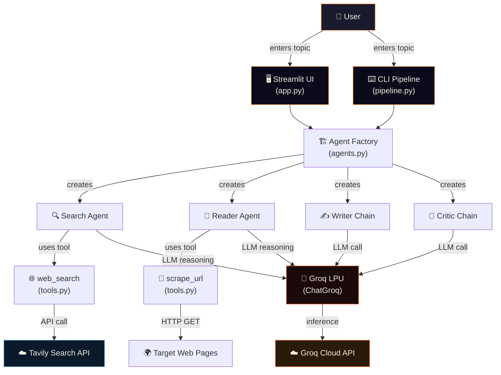
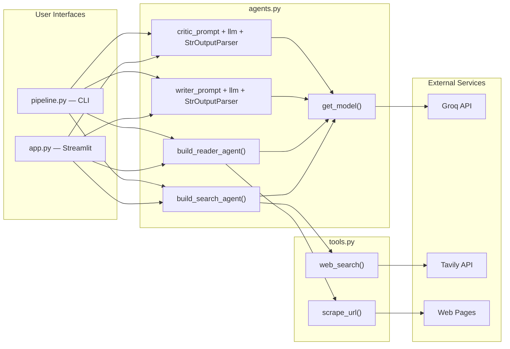

<p align="center">
  <h1 align="center">🔬 ResearchMind</h1>
  <p align="center"><strong>Multi-Agent AI Research System</strong></p>
  <p align="center">
    Four specialized AI agents collaborate — searching, scraping, writing, and critiquing — to deliver polished research reports on any topic.
  </p>
</p>

<p align="center">
  
  
  
  
  
</p>

---

## Table of Contents

- [Overview](#overview)
- [Problem Statement & Motivation](#problem-statement--motivation)
- [Key Features](#key-features)
- [Demo & Screenshots](#demo--screenshots)
- [Technology Stack](#technology-stack)
- [System Architecture](#system-architecture)
- [End-to-End Workflow](#end-to-end-workflow)
- [Component Deep Dive](#component-deep-dive)
  - [Tools Layer — `tools.py`](#1-tools-layer--toolspy)
  - [Agent & Chain Definitions — `agents.py`](#2-agent--chain-definitions--agentspy)
  - [CLI Pipeline — `pipeline.py`](#3-cli-pipeline--pipelinepy)
  - [Streamlit Frontend — `app.py`](#4-streamlit-frontend--apppy)
- [Core Technical Principles](#core-technical-principles)
- [API & External Integrations](#api--external-integrations)
- [Installation & Setup](#installation--setup)
- [Environment Variables](#environment-variables)
- [Running the Application](#running-the-application)
- [Security Considerations](#security-considerations)
- [Limitations & Known Issues](#limitations--known-issues)
- [Troubleshooting](#troubleshooting)
- [Project Structure](#project-structure)
- [Technical Decisions & Trade-offs](#technical-decisions--trade-offs)
- [Project Interview Preparation Guide](#project-interview-preparation-guide)
- [Future Improvements](#future-improvements)

---

## Overview

**ResearchMind** is an AI-powered research assistant built as a **multi-agent pipeline**. Given any topic, it orchestrates four specialized stages:

1. **Search Agent** — Queries the web using the Tavily Search API to find recent, relevant sources.
2. **Reader Agent** — Scrapes the most relevant URL to extract deep textual content.
3. **Writer Chain** — Synthesizes all gathered research into a structured, professional report.
4. **Critic Chain** — Reviews and scores the report with strengths, weaknesses, and a verdict.

The system exposes two interfaces:
- A **Streamlit web application** (`app.py`) with a premium dark-themed UI featuring real-time pipeline status tracking, downloadable reports, and structured critic feedback.
- A **CLI pipeline** (`pipeline.py`) for terminal-based execution.

Every agent runs on a Large Language Model (LLM) hosted on **Groq's LPU Inference Engine** via the `ChatGroq` integration, enabling fast inference with low latency.

---

## Problem Statement & Motivation

### The Problem

Researching a topic thoroughly requires multiple tedious steps: searching for sources, opening dozens of tabs, reading long articles, synthesizing findings into coherent prose, and then self-reviewing for quality. This workflow is:

- **Time-consuming** — A single research report can take hours of manual effort.
- **Inconsistent** — Quality depends on the researcher's stamina and attention span.
- **Shallow** — People often stop at search snippets without reading full articles.
- **Unreviewed** — Self-editing introduces bias; there is rarely a built-in quality check.

### The Solution

ResearchMind automates the entire research lifecycle by decomposing it into **specialized agent roles**. Each agent focuses on one task, and their outputs chain together:

| Manual Step | ResearchMind Agent |
|---|---|
| Searching Google / news sites | **Search Agent** (Tavily API) |
| Opening and reading articles | **Reader Agent** (BeautifulSoup scraper) |
| Writing a synthesis report | **Writer Chain** (LLM with structured prompt) |
| Self-reviewing and scoring | **Critic Chain** (LLM with evaluation prompt) |

### Key Insight

Rather than using a single monolithic LLM prompt to "research and write about X," the system separates **information retrieval** (real-time web data) from **information synthesis** (LLM generation) from **quality assurance** (LLM critique). This separation produces more grounded, higher-quality reports because:

- The LLM writes from **actual retrieved data**, not hallucinated knowledge.
- A dedicated critic provides **structured feedback**, catching issues the writer might miss.
- Each stage can be independently tested, debugged, and improved.

---

## Key Features

### Core Functionality
- **Automated 4-stage research pipeline** — Search → Read → Write → Critique, fully automated from a single topic input.
- **Real-time web search** — Tavily Search API retrieves up-to-date information (not limited to LLM training cutoff).
- **Deep content extraction** — BeautifulSoup-based scraper extracts clean text from web pages, stripping navigation, scripts, and styling.
- **Structured report generation** — LLM produces reports with Introduction, Key Findings, Conclusion, and Sources sections.
- **Automated quality review** — Critic agent scores reports on a 1-10 scale with specific strengths and improvement areas.

### User-Facing Features
- **Premium Streamlit UI** — Dark-themed interface with custom typography (Syne, DM Mono, DM Sans), gradient accents, glassmorphism cards, and micro-animations.
- **Real-time pipeline tracker** — Visual step cards show waiting/running/done status for each agent.
- **Quick suggestion chips** — Pre-filled topic suggestions for instant exploration.
- **Markdown report download** — One-click download of the final report as a `.md` file.
- **Expandable raw outputs** — Search results and scraped content available in collapsible panels for transparency.

### Reliability & Error Handling
- **Configurable model selection** — `GROQ_MODEL` environment variable allows switching LLM models without code changes.
- **API key validation** — Startup checks verify `GROQ_API_KEY` is configured before any API calls.
- **Graceful error handling** — Model-not-found errors, API errors, and general exceptions produce actionable Streamlit error messages rather than raw tracebacks.
- **Scraper fault tolerance** — URL scraping catches exceptions and returns descriptive error messages instead of crashing the pipeline.

---

## Demo & Screenshots

> **Note:** Screenshots are not currently included in the repository. To see the application in action, run it locally following the [Installation & Setup](#installation--setup) instructions.
>
> **Expected UI:** A dark-themed page with an orange accent color, centered "ResearchMind" hero heading, a topic input form on the left, pipeline status cards on the right, and results displayed below after execution.

---

## Technology Stack

| Technology | Category | Role in This Project | Why This Choice |
|---|---|---|---|
| **Python 3.10+** | Language | Core application language for all modules | De-facto standard for AI/ML and LangChain ecosystem |
| **LangChain** | LLM Framework | Agent creation (`create_agent`), prompt templates, output parsers, LCEL chain composition | Provides the agent abstraction layer, tool binding, and chain piping (`\|` operator) |
| **LangChain-Groq** | LLM Provider Integration | `ChatGroq` wrapper connects LangChain to Groq's API | Enables using Groq-hosted models within LangChain's agent/chain framework |
| **Groq LPU** | LLM Inference | Hosts the LLM (`openai/gpt-oss-20b`) used by all agents and chains | Ultra-fast inference speeds via dedicated Language Processing Units |
| **Tavily API** | Search Engine | Provides web search results (titles, URLs, snippets) for the Search Agent | Purpose-built for AI agent search — returns structured, relevant results optimized for LLM consumption |
| **BeautifulSoup4** | Web Scraping | Extracts clean text from web pages for the Reader Agent | Lightweight HTML parser; handles malformed HTML gracefully |
| **Streamlit** | Frontend Framework | Renders the web UI, handles user input, manages session state, displays results | Rapid Python-native web app development; no separate frontend codebase needed |
| **python-dotenv** | Configuration | Loads `.env` files for API keys and model configuration | Standard approach for managing secrets outside source code |
| **Rich** | Terminal Formatting | Enhanced console output in CLI mode (`pipeline.py`) | Prettier terminal output during pipeline execution |
| **Requests** | HTTP Client | Makes GET requests for URL scraping | Standard Python HTTP library; simple and reliable |

### Not Actively Used (Listed in `requirements.txt` but not imported in source code)

| Technology | Status |
|---|---|
| `langchain-openai` | Listed as dependency, not imported — likely included for potential future use |
| `pandas` | Listed as optional, not used in current codebase |
| `tiktoken` | Listed for token counting, not currently used |
| `aiohttp` | Listed for async support, not currently used (pipeline runs synchronously) |
| `tenacity` | Listed for retry logic, not currently implemented |
| `orjson` | Listed for JSON handling, not currently used |
| `html5lib` | Listed as optional HTML parser, not currently used (BeautifulSoup uses default parser) |

---

## System Architecture

### High-Level Architecture



### Component Architecture



### Architecture Explanation

The system follows a **layered architecture** with three distinct layers:

1. **Tools Layer** (`tools.py`) — Contains two LangChain `@tool`-decorated functions that interface with external services. These are pure I/O functions with no LLM logic.

2. **Agent/Chain Layer** (`agents.py`) — Defines the model factory and constructs four AI components:
   - Two **ReAct agents** (Search, Reader) that combine LLM reasoning with tool execution.
   - Two **LCEL chains** (Writer, Critic) that pipe a prompt template through the LLM and parse the output.

3. **Interface Layer** (`app.py`, `pipeline.py`) — Orchestrates the four-stage pipeline and presents results to the user. The Streamlit app adds session state management, visual status tracking, and error handling.

**Data flows downward** through the layers: Interface → Agents/Chains → Tools → External APIs. **Results flow upward**: External APIs → Tools → Agents/Chains → Interface → User.

---

## End-to-End Workflow

### Primary Workflow: Research Pipeline

```mermaid
sequenceDiagram
    actor User
    participant UI as Streamlit UI
    participant SA as Search Agent
    participant LLM as Groq LLM
    participant Tavily as Tavily API
    participant RA as Reader Agent
    participant Web as Target Webpage
    participant WC as Writer Chain
    participant CC as Critic Chain

    User->>UI: Enter topic & click "Run Research Pipeline"
    UI->>UI: Validate topic is not empty
    UI->>UI: Set session_state.running = True
    UI->>UI: st.rerun() to show pipeline status

    rect rgb(40, 30, 20)
        Note over UI,Tavily: Step 1 — Search Agent
        UI->>SA: invoke(messages: "Find info about {topic}")
        SA->>LLM: Reason about query → decide to call web_search
        LLM-->>SA: Tool call: web_search(query="...")
        SA->>Tavily: tavily.search(query, max_results=5)
        Tavily-->>SA: [{title, url, content}, ...]
        SA->>SA: Format results as Title/URL/Snippet strings
        SA->>LLM: Present tool results → generate summary
        LLM-->>SA: Final AI message with search summary
        SA-->>UI: {messages: [..., AIMessage(content=search_results)]}
        UI->>UI: Store results["search"]
    end

    rect rgb(30, 30, 40)
        Note over UI,Web: Step 2 — Reader Agent
        UI->>RA: invoke(messages: "Pick URL and scrape: {search_results[:800]}")
        RA->>LLM: Reason about URLs → decide to call scrape_url
        LLM-->>RA: Tool call: scrape_url(url="...")
        RA->>Web: HTTP GET with User-Agent header
        Web-->>RA: HTML response
        RA->>RA: BeautifulSoup parse → strip scripts/nav → extract text[:3000]
        RA->>LLM: Present scraped content → generate summary
        LLM-->>RA: Final AI message with scraped content
        RA-->>UI: {messages: [..., AIMessage(content=scraped_content)]}
        UI->>UI: Store results["reader"]
    end

    rect rgb(40, 30, 30)
        Note over UI,LLM: Step 3 — Writer Chain
        UI->>UI: Combine search_results + scraped_content
        UI->>WC: invoke(topic, research=combined)
        WC->>LLM: System: "expert research writer" + Human: structured prompt
        LLM-->>WC: Full research report (Intro, Findings, Conclusion, Sources)
        WC->>WC: StrOutputParser extracts text
        WC-->>UI: report string
        UI->>UI: Store results["writer"]
    end

    rect rgb(30, 40, 30)
        Note over UI,LLM: Step 4 — Critic Chain
        UI->>CC: invoke(report=writer_output)
        CC->>LLM: System: "sharp research critic" + Human: evaluation prompt
        LLM-->>CC: Score, Strengths, Areas to Improve, Verdict
        CC->>CC: StrOutputParser extracts text
        CC-->>UI: feedback string
        UI->>UI: Store results["critic"]
    end

    UI->>UI: Set running=False, done=True
    UI->>UI: st.rerun() to display results
    UI-->>User: Display report, critic feedback, download button
```



### Data Lineage

```
User Input (topic string)
  │
  ├─► Search Agent
  │     └─► Tavily API query → 5 results [{title, url, snippet}]
  │         └─► Formatted string: "Title: ...\nURL: ...\nSnippet: ...\n----\n..."
  │             └─► LLM summarizes → search_results (string)
  │
  ├─► Reader Agent (receives search_results[:800])
  │     └─► LLM selects URL → scrape_url(url)
  │         └─► HTTP GET → HTML → BeautifulSoup → clean_text[:3000]
  │             └─► LLM summarizes → scraped_content (string)
  │
  ├─► Writer Chain (receives topic + search_results + scraped_content)
  │     └─► Prompt template fills {topic} and {research}
  │         └─► LLM generates → structured report (markdown string)
  │
  └─► Critic Chain (receives report)
        └─► Prompt template fills {report}
            └─► LLM evaluates → "Score: X/10\nStrengths:...\nAreas to Improve:..."
```

---

## Component Deep Dive

### 1. Tools Layer — `tools.py`

**Purpose:** Provides two LangChain-compatible tools that give agents the ability to interact with the external world — searching the web and scraping web pages.

**Location:** [`tools.py`](Multi-agent-research-system-main/tools.py)

#### `web_search(query: str) → str`

| Aspect | Detail |
|---|---|
| **Responsibility** | Query the Tavily Search API and return formatted results |
| **Input** | A search query string (decided by the Search Agent's LLM) |
| **Process** | Calls `tavily.search(query, max_results=5)`, iterates results, formats each as `Title: ...\nURL: ...\nSnippet: ...\n` |
| **Output** | A single string with up to 5 results separated by `\n----\n` |
| **Snippet truncation** | Each snippet is truncated to 300 characters to keep context manageable |
| **Error handling** | None — Tavily exceptions propagate to the agent |
| **Decorator** | `@tool` — makes it discoverable by LangChain's agent framework |

#### `scrape_url(url: str) → str`

| Aspect | Detail |
|---|---|
| **Responsibility** | Fetch a web page and extract clean text content |
| **Input** | A URL string (decided by the Reader Agent's LLM) |
| **Process** | `requests.GET` with 8s timeout and User-Agent header → BeautifulSoup parse → remove `<script>`, `<style>`, `<nav>`, `<footer>` tags → extract text |
| **Output** | Clean text string, truncated to 3,000 characters |
| **Error handling** | Returns `"Could not scrape URL: {error}"` instead of raising |
| **Key design choice** | 3,000-character limit prevents overloading the LLM's context window |

#### Core Principle: Tool-Augmented LLM Agents

LLMs are powerful reasoners but have no ability to access real-time information or interact with the internet. **LangChain tools** bridge this gap by:

1. Decorating Python functions with `@tool` and a docstring.
2. The agent framework converts the docstring + function signature into a tool schema.
3. The LLM receives this schema and can decide when to call a tool.
4. The framework executes the function and returns the result to the LLM.

This is an implementation of the **ReAct (Reasoning + Acting) pattern** — the LLM reasons about what tool to use, acts by calling it, observes the result, and then reasons again.

---

### 2. Agent & Chain Definitions — `agents.py`

**Purpose:** Central configuration file that creates the LLM instance and constructs all four AI components used by the pipeline.

**Location:** [`agents.py`](Multi-agent-research-system-main/agents.py)

#### Model Factory: `get_model(temperature=0)`

```python
def get_model(temperature: float = 0) -> ChatGroq:
    model_name = os.getenv("GROQ_MODEL", DEFAULT_MODEL)
    return ChatGroq(model=model_name, temperature=temperature)
```

- Reads `GROQ_MODEL` from environment variables, defaults to `openai/gpt-oss-20b`.
- `temperature=0` ensures deterministic, focused outputs (no randomness).
- Returns a fresh `ChatGroq` instance each time — agents get independent model instances.

#### Search Agent: `build_search_agent()`

```python
def build_search_agent():
    return create_agent(model=get_model(temperature=0), tools=[web_search])
```

- Uses LangChain's `create_agent()` to build a **ReAct agent** — an LLM that can reason and call tools in a loop.
- Bound tool: `web_search` — the agent decides what query to search and when to stop.
- Returns a compiled `CompiledGraph` (LangGraph-based agent) that accepts `{"messages": [...]}` and returns `{"messages": [...]}`.

#### Reader Agent: `build_reader_agent()`

- Identical pattern to Search Agent but bound to `scrape_url` instead.
- The LLM receives search results, picks the most relevant URL, and calls `scrape_url`.

#### Writer Chain (LCEL)

```python
writer_chain = writer_prompt | llm | StrOutputParser()
```

This is a **LangChain Expression Language (LCEL) chain** — a pipeline composed using the `|` operator:

1. **`writer_prompt`** — A `ChatPromptTemplate` with two messages:
   - System: "You are an expert research writer."
   - Human: A structured prompt requesting a report with Introduction, Key Findings (minimum 3), Conclusion, and Sources.
2. **`llm`** — The `ChatGroq` model instance.
3. **`StrOutputParser()`** — Extracts the string content from the LLM's `AIMessage`.

**Input:** `{"topic": str, "research": str}`
**Output:** A markdown-formatted research report string.

#### Critic Chain (LCEL)

Same LCEL pattern as the Writer Chain, but with a different prompt:

- System: "You are a sharp and constructive research critic."
- Human: Requests a structured review with `Score: X/10`, `Strengths`, `Areas to Improve`, and `One line verdict`.

**Input:** `{"report": str}`
**Output:** A structured critique string.

#### Key Distinction: Agents vs. Chains

| Aspect | ReAct Agent (Search, Reader) | LCEL Chain (Writer, Critic) |
|---|---|---|
| **Can call tools** | ✅ Yes | ❌ No |
| **Multi-step reasoning** | ✅ Loops until done | ❌ Single pass |
| **Input format** | `{"messages": [...]}` | `{"key": "value", ...}` |
| **Output format** | `{"messages": [...]}` | Raw string |
| **Use case** | Needs external data | Pure text transformation |
| **Underlying** | LangGraph `CompiledGraph` | LCEL pipeline |

---

### 3. CLI Pipeline — `pipeline.py`

**Purpose:** Orchestrates the four-stage pipeline as a sequential script for terminal execution.

**Location:** [`pipeline.py`](Multi-agent-research-system-main/pipeline.py)

**Execution flow:**

1. Accepts a topic string as input.
2. Creates Search Agent → invokes → stores `search_results`.
3. Creates Reader Agent → invokes with search results (first 800 chars) → stores `scraped_content`.
4. Combines search + scraped content → invokes Writer Chain → stores `report`.
5. Invokes Critic Chain with the report → stores `feedback`.
6. Returns a state dictionary: `{search_results, scraped_content, report, feedback}`.

**Error handling:** Catches `groq.NotFoundError` specifically and provides an actionable message about updating `GROQ_MODEL`.

**Entry point:** `python pipeline.py` — prompts for a topic via `input()`.

---

### 4. Streamlit Frontend — `app.py`

**Purpose:** Provides a polished web interface for the research pipeline with real-time status tracking and result display.

**Location:** [`app.py`](Multi-agent-research-system-main/app.py)

#### UI Architecture

The app is structured in five visual sections:

1. **Hero Section** — Centered title "ResearchMind" with eyebrow text and description.
2. **Input Section** (left column) — Form with text input and submit button, plus suggestion chip buttons.
3. **Pipeline Tracker** (right column) — Four step cards showing waiting/running/done status.
4. **Results Section** — Expandable raw outputs, rendered report panel, and critic feedback panel.
5. **Footer** — Attribution line.

#### Session State Management

```python
st.session_state.results  # dict: accumulated pipeline outputs
st.session_state.running  # bool: is pipeline executing?
st.session_state.done     # bool: has pipeline completed?
st.session_state.active_topic  # str: the topic being researched
```

Streamlit reruns the entire script on every interaction. Session state persists across reruns to maintain pipeline progress.

#### Pipeline Execution Logic

```
User clicks "Run" → validate topic → set running=True → st.rerun()
  → if running and not done:
    → try:
        → Step 1: Search Agent (with spinner)
        → Step 2: Reader Agent (with spinner)
        → Step 3: Writer Chain (with spinner)
        → Step 4: Critic Chain (with spinner)
        → Set done=True → st.rerun()
    → except groq.NotFoundError → actionable error message
    → except groq.GroqError → API error message
    → except Exception → generic/model-not-found error message
```

#### Custom CSS Design System

The app includes ~330 lines of custom CSS implementing:

- **Color palette:** Dark background (`#0a0a0f`), warm orange accent (`#ff8c32`), green for completion (`#50c878`).
- **Typography:** Syne (headings), DM Mono (labels/status), DM Sans (body) — loaded from Google Fonts.
- **Glassmorphism:** `backdrop-filter: blur()` on form containers.
- **Micro-animations:** `transition` on hover states for buttons and cards, `translateY` lift effects.
- **Gradient accents:** Linear gradients on buttons and radial gradients on the background.

---

## Core Technical Principles

### 1. ReAct Agent Pattern

**Principle:** The ReAct (Reasoning + Acting) framework allows an LLM to alternate between *thinking* (reasoning about what to do) and *acting* (calling tools). The loop continues until the LLM decides it has enough information to answer.

**In this project:** The Search and Reader agents use ReAct. When the Search Agent receives "Find info about quantum computing," the LLM:
1. **Thinks:** "I should search for recent quantum computing information."
2. **Acts:** Calls `web_search(query="quantum computing breakthroughs 2025")`.
3. **Observes:** Reads the tool's output (titles, URLs, snippets).
4. **Thinks:** "I now have enough information to summarize."
5. **Acts:** Produces a final response.

**Implementation:** `langchain.agents.create_agent()` builds a LangGraph-based ReAct agent that manages this loop automatically.

### 2. LCEL (LangChain Expression Language) Chains

**Principle:** LCEL allows composing LLM pipelines using the `|` (pipe) operator, where each component's output becomes the next component's input.

**In this project:**
```python
writer_chain = writer_prompt | llm | StrOutputParser()
```

This is equivalent to:
```python
formatted_messages = writer_prompt.format_messages(topic=topic, research=research)
ai_message = llm.invoke(formatted_messages)
result_string = StrOutputParser().parse(ai_message)
```

**Advantage:** LCEL chains are composable, serializable, and support streaming, batching, and async execution out of the box.

### 3. Prompt Engineering

**Writer Prompt Strategy:**
- System message establishes role: "expert research writer."
- Human message provides a **structured template** with explicit section headings (Introduction, Key Findings, Conclusion, Sources).
- Specifies "minimum 3 well-explained points" to ensure depth.
- Instructs "Be detailed, factual and professional" to set quality expectations.

**Critic Prompt Strategy:**
- System message establishes adversarial role: "sharp and constructive research critic."
- Enforces a **fixed response format** (`Score: X/10`, `Strengths:`, `Areas to Improve:`, `One line verdict:`) to ensure parseable, consistent output.

### 4. Context Window Management

The system carefully manages the amount of text passed between stages:

| Stage | Truncation | Reason |
|---|---|---|
| `web_search` snippets | 300 chars each | Keep individual results concise |
| `scrape_url` output | 3,000 chars | Prevent overwhelming the LLM context |
| Search results → Reader | 800 chars | Reader only needs enough to pick a URL |

This prevents context window overflow while maintaining enough information for quality outputs.

---

## API & External Integrations

### Groq API (LLM Inference)

| Aspect | Detail |
|---|---|
| **Purpose** | Hosts the LLM used by all agents and chains |
| **Model** | `openai/gpt-oss-20b` (configurable via `GROQ_MODEL`) |
| **Auth** | API key via `GROQ_API_KEY` environment variable |
| **Endpoint** | `https://api.groq.com/openai/v1/chat/completions` (via `ChatGroq` SDK) |
| **Rate limits** | Subject to Groq free-tier limits (varies by model and account tier) |
| **Error handling** | `groq.NotFoundError` for invalid models, `groq.GroqError` for API failures |
| **Security** | API key stored in `.env`, validated at startup, never printed |

### Tavily Search API

| Aspect | Detail |
|---|---|
| **Purpose** | Web search optimized for AI agent consumption |
| **Auth** | API key via `TAVILY_API_KEY` environment variable |
| **Request** | `tavily.search(query=str, max_results=5)` |
| **Response** | `{"results": [{"title": str, "url": str, "content": str}, ...]}` |
| **Rate limits** | Subject to Tavily plan limits (free tier: 1,000 searches/month) |
| **Error handling** | Exceptions propagate — not currently caught in `web_search()` |

### Web Page Scraping (HTTP)

| Aspect | Detail |
|---|---|
| **Purpose** | Fetch raw HTML from URLs identified by search results |
| **Method** | `requests.get(url, timeout=8, headers={"User-Agent": "Mozilla/5.0"})` |
| **Processing** | BeautifulSoup parses HTML, removes `<script>`, `<style>`, `<nav>`, `<footer>`, extracts text |
| **Rate limits** | None implemented — single request per pipeline run |
| **Error handling** | Returns error string on any exception (timeout, connection error, etc.) |

---

## Installation & Setup

### Prerequisites

- **Python 3.10 or higher**
- **pip** (Python package manager)
- **Groq API key** — Get one at [console.groq.com](https://console.groq.com)
- **Tavily API key** — Get one at [tavily.com](https://tavily.com)

### Step-by-step Setup

```bash
# 1. Clone the repository
git clone https://github.com/YOUR_USERNAME/Multi-agent-research-system.git
cd Multi-agent-research-system

# 2. Create a virtual environment
python -m venv .venv

# 3. Activate the virtual environment
# Windows (PowerShell):
.\.venv\Scripts\Activate.ps1
# Windows (cmd):
.venv\Scripts\activate.bat
# macOS/Linux:
source .venv/bin/activate

# 4. Install dependencies
pip install -r requirements.txt

# 5. Create your environment file
cp .env.example .env

# 6. Edit .env with your API keys (use any text editor)
# Replace placeholder values with your actual keys
```

---

## Environment Variables

Create a `.env` file in the project root with the following variables:

```env
GROQ_API_KEY=your_groq_api_key_here
TAVILY_API_KEY=your_tavily_api_key_here
GROQ_MODEL=openai/gpt-oss-20b
```

| Variable | Required | Description |
|---|---|---|
| `GROQ_API_KEY` | ✅ Yes | Your Groq API key for LLM inference |
| `TAVILY_API_KEY` | ✅ Yes | Your Tavily API key for web search |
| `GROQ_MODEL` | ❌ Optional | Groq model ID (defaults to `openai/gpt-oss-20b`) |

> ⚠️ **Never commit your `.env` file to version control.** The `.gitignore` already excludes it.

---

## Running the Application

### Streamlit Web App (Recommended)

```bash
cd Multi-agent-research-system-main
streamlit run app.py
```

Opens at `http://localhost:8501`. Enter a topic and click **⚡ Run Research Pipeline**.

### CLI Pipeline

```bash
cd Multi-agent-research-system-main
python pipeline.py
```

Enter a topic when prompted. Results print to the terminal.

---

## Security Considerations

### Implemented

- ✅ API keys stored in `.env` file, not hardcoded in source.
- ✅ `.gitignore` excludes `.env` from version control.
- ✅ Startup validation checks that `GROQ_API_KEY` is set.
- ✅ Keys loaded via `python-dotenv`, not passed as CLI arguments.

### Gaps & Risks

- ⚠️ **No input sanitization on topic** — User input is directly interpolated into prompts and passed to the LLM. In a multi-user deployment, this could enable **prompt injection** (a user crafting a topic that manipulates the LLM's behavior).
- ⚠️ **No authentication on Streamlit** — Anyone with network access to the Streamlit server can use the application and consume API credits.
- ⚠️ **No rate limiting** — Repeated rapid submissions could exhaust Groq/Tavily API quotas.
- ⚠️ **Scraper User-Agent** — The fixed `"Mozilla/5.0"` User-Agent in `scrape_url` does not identify the bot, which some sites may consider deceptive.
- ⚠️ **Raw HTML rendering in results** — Search results are rendered via `unsafe_allow_html=True`, which could be an XSS vector if Tavily returns malicious content (unlikely but worth noting).
- ⚠️ **`TAVILY_API_KEY` not validated at startup** — Unlike `GROQ_API_KEY`, there is no startup check for the Tavily key.

---

## Limitations & Known Issues

1. **Single-URL scraping** — The Reader Agent only scrapes one URL per run. A more thorough system would scrape multiple sources.
2. **Synchronous execution** — All four stages run sequentially. Stages 1 and 2 could potentially overlap with async execution.
3. **No caching** — Identical topics trigger full re-execution. Implementing a cache for search results would reduce API usage.
4. **No report iteration** — The Critic provides feedback, but the Writer doesn't revise based on it. A feedback loop could improve quality.
5. **3,000-char scrape limit** — Long-form articles are aggressively truncated, potentially missing key content.
6. **No PDF/file output** — Reports are only downloadable as Markdown. PDF generation would improve professional use.
7. **Model availability** — Groq's model catalog changes over time. The default model (`openai/gpt-oss-20b`) may be deprecated in the future; the `GROQ_MODEL` environment variable mitigates this.
8. **No conversation memory** — Each pipeline run is independent. There is no chat history or ability to refine a previous research topic.

---

## Troubleshooting

| Problem | Cause | Solution |
|---|---|---|
| `groq.NotFoundError: model does not exist` | Model ID retired or unavailable | Check Groq's model catalog; update `GROQ_MODEL` in `.env` |
| `ValueError: GROQ_API_KEY not set` | Missing API key | Add `GROQ_API_KEY=gsk_...` to your `.env` file |
| `File does not exist: app.py` | Wrong working directory | `cd` into `Multi-agent-research-system-main/` before running `streamlit run app.py` |
| `ModuleNotFoundError: No module named 'langchain'` | Dependencies not installed | Run `pip install -r requirements.txt` in your virtual environment |
| Tavily search returns empty results | Invalid or expired API key | Verify `TAVILY_API_KEY` in `.env`; check Tavily dashboard for quota |
| Scraper returns "Could not scrape URL" | Target site blocks bots or is down | Expected behavior — the pipeline continues with available data |
| Streamlit spinner hangs for minutes | Slow LLM inference or rate limiting | Wait for Groq response; check Groq status page |

---

## Project Structure

```
Multi-agent-research-system-main/
├── .env                  # API keys & model config (git-ignored)
├── .env.example          # Template for environment variables
├── .gitignore            # Excludes .env from version control
├── requirements.txt      # Python dependencies
├── app.py                # Streamlit web application (590 lines)
│                           ├── Custom CSS design system (~330 lines)
│                           ├── step_card() helper for pipeline visualization
│                           ├── Session state management
│                           ├── Pipeline execution with error handling
│                           └── Results display with download button
├── agents.py             # Agent & chain definitions (100 lines)
│                           ├── get_model() — configurable ChatGroq factory
│                           ├── build_search_agent() — ReAct agent + web_search
│                           ├── build_reader_agent() — ReAct agent + scrape_url
│                           ├── writer_chain — LCEL prompt|llm|parser
│                           └── critic_chain — LCEL prompt|llm|parser
├── tools.py              # LangChain tool functions (42 lines)
│                           ├── web_search() — Tavily API wrapper
│                           └── scrape_url() — BeautifulSoup scraper
└── pipeline.py           # CLI orchestrator (87 lines)
                            ├── run_research_pipeline() — 4-stage sequential pipeline
                            └── __main__ entry point with input()
```

---

## Technical Decisions & Trade-offs

### 1. Why Groq instead of OpenAI or local models?

**Decision:** Use Groq's LPU Inference Engine for LLM hosting.

**Reasoning (inferred):** Groq offers significantly faster inference than OpenAI for similar model sizes. The free tier allows prototyping without cost. The LangChain integration (`ChatGroq`) is a drop-in replacement for `ChatOpenAI`.

**Trade-off:** Groq's model catalog is smaller and changes frequently. Models get deprecated (as happened with `llama-3.3-70b-versatile`), requiring configuration updates. OpenAI would offer more stable model availability.

### 2. Why Tavily instead of Google Search or SerpAPI?

**Decision:** Use Tavily's AI-optimized search API.

**Reasoning (inferred):** Tavily is specifically designed for AI agents — it returns clean, structured results optimized for LLM consumption. Google Custom Search requires more setup and returns noisier results. Tavily's LangChain integration is seamless.

**Trade-off:** Tavily's free tier has a 1,000 searches/month limit. Google Custom Search offers higher free quotas but requires more post-processing.

### 3. Why separate agents instead of one monolithic prompt?

**Decision:** Four specialized stages rather than "research and write about X" in one prompt.

**Reasoning:** Separation of concerns allows the LLM to focus on one task at a time, produces more grounded outputs (real web data, not hallucinations), and makes each stage independently testable and debuggable.

**Trade-off:** More API calls (4+ LLM invocations per pipeline run), higher latency, and more complexity. A single prompt would be simpler but would rely entirely on the LLM's training data.

### 4. Why LCEL chains for Writer/Critic instead of agents?

**Decision:** Writer and Critic are simple `prompt | llm | parser` chains, not tool-using agents.

**Reasoning:** These stages don't need external tools — they only transform text. Using an agent would add unnecessary overhead (the ReAct loop) for a single-pass LLM call.

### 5. Why synchronous execution?

**Decision:** All four stages run sequentially, blocking the Streamlit UI.

**Trade-off:** The UI freezes during execution (mitigated by spinners). Async or threaded execution would allow progress updates but adds significant complexity to Streamlit's execution model.

---

## Project Interview Preparation Guide

### A. Project Explanations

#### 30-Second Elevator Pitch

> "ResearchMind is a multi-agent AI system that automates the research workflow. You give it a topic, and four specialized AI agents collaborate to search the web, scrape relevant articles, write a structured report, and review it with a quality score. It's built with LangChain, Groq for fast LLM inference, and Streamlit for the UI."

#### 1-Minute Explanation

> "I built ResearchMind to automate the tedious parts of research. The system uses a multi-agent architecture where each agent has a specialized role. The Search Agent uses the Tavily API to find recent web results. The Reader Agent picks the most relevant URL and scrapes its content using BeautifulSoup. Then a Writer Chain — which is a LangChain LCEL pipeline — synthesizes everything into a structured report with an introduction, key findings, conclusion, and sources. Finally, a Critic Chain evaluates the report and gives a score out of 10 with specific feedback. All four components use the same Groq-hosted LLM, but the Search and Reader agents use the ReAct pattern with tool calling, while the Writer and Critic are simple prompt-to-output chains. The whole thing is wrapped in a Streamlit web app with real-time status tracking."

#### Most Technically Challenging Part

> "The most interesting technical challenge was designing the data flow between agents. Each stage produces output that the next stage consumes, but the formats differ — agents return message arrays while chains return strings. I also had to carefully manage context window limits: search snippets are truncated to 300 characters, scraped content to 3,000 characters, and only the first 800 characters of search results are passed to the Reader Agent. Getting this balance right — enough information for quality output without overflowing the context — required iterative testing."

---

### B. Technical Interview Questions & Answers

<details>
<summary><strong>Click to expand: 25+ interview questions with answers</strong></summary>

#### Architecture & System Design

**Q1: Why did you use a multi-agent architecture instead of a single LLM call?**

> A single prompt like "research and write about X" would rely entirely on the LLM's training data, which has a knowledge cutoff. By separating search, reading, writing, and reviewing into distinct agents, I can ground the LLM's output in real-time web data. The Search Agent retrieves current information via Tavily, the Reader Agent extracts deep content from actual web pages, and only then does the Writer Chain synthesize a report. This separation also makes each stage independently testable — I can verify the Search Agent returns relevant URLs without running the entire pipeline.

**Q2: Explain the difference between your agents and your chains. Why are some components agents and others chains?**

> The Search and Reader agents need to interact with external tools — Tavily search and web scraping. They use the ReAct (Reasoning + Acting) pattern where the LLM decides when and how to call a tool, observes the result, and reasons about what to do next. This requires a multi-step loop managed by LangGraph. The Writer and Critic, however, are pure text-in/text-out transformations — they don't need tools. So I used LCEL chains, which are simpler: `prompt | llm | parser`. Using an agent for the Writer would add unnecessary overhead since it would just do a single LLM call anyway.

**Q3: How does data flow from the user's topic input to the final report?**

> The user enters a topic string. Step 1: The Search Agent receives this topic as a message, reasons about it, and calls `web_search()` which queries Tavily for 5 results. The results are formatted as title/URL/snippet strings. Step 2: The first 800 characters of search results are passed to the Reader Agent, which picks the most relevant URL and calls `scrape_url()` to extract clean text (up to 3,000 chars). Step 3: The search results and scraped content are concatenated and passed to the Writer Chain along with the topic. The prompt template structures the request for a report with Introduction, Key Findings, Conclusion, and Sources. Step 4: The writer's output goes to the Critic Chain, which scores it 1-10 with structured feedback.

**Q4: What happens if the web scraper fails?**

> The `scrape_url()` function has a try-except block that catches any exception — timeouts, connection errors, HTTP errors — and returns a string like `"Could not scrape URL: Connection timed out"`. This means the Reader Agent receives an error message instead of crashing. The LLM then includes this context in its response, and the Writer Chain works with whatever data is available. The pipeline degrades gracefully rather than failing completely.

#### LangChain & LLM Concepts

**Q5: What is LCEL and how do you use it?**

> LCEL — LangChain Expression Language — lets you compose LLM pipelines using the pipe operator. My Writer Chain is `writer_prompt | llm | StrOutputParser()`. When I call `writer_chain.invoke({"topic": "AI", "research": "..."})`, the prompt template formats the messages, passes them to the LLM, and the parser extracts the content string from the response. It's essentially functional composition — each component is a `Runnable` with `.invoke()`, and piping them chains the outputs to inputs.

**Q6: What is the ReAct pattern and where do you implement it?**

> ReAct stands for Reasoning + Acting. It's a prompting paradigm where the LLM alternates between thinking about what to do and executing actions (tool calls). In my project, `create_agent()` builds a ReAct agent backed by LangGraph. When the Search Agent receives "Find info about quantum computing," the LLM thinks "I should search for this," calls `web_search(query="quantum computing 2025")`, observes the results, thinks "I have enough information," and produces a summary. The key insight is that the LLM decides *when* and *how* to use tools, rather than following a fixed sequence.

**Q7: Why do you set `temperature=0` for all models?**

> Temperature controls randomness in LLM output. `temperature=0` gives deterministic, focused responses — the model always picks the highest-probability token. For a research system, this is important because I want factual, consistent outputs rather than creative variations. If I ran the same topic twice, I'd want similar quality and structure. Higher temperature would introduce variation that's undesirable in a factual research context.

#### Tools & External APIs

**Q8: Why do you truncate search snippets to 300 characters and scraped content to 3,000 characters?**

> These limits manage the LLM's context window. If I passed full articles (potentially 50,000+ characters), I'd overflow the context window and the API call would fail or the model would lose track of earlier content. 300 characters per snippet × 5 results = ~1,500 characters for search — enough to identify relevance and URLs. 3,000 characters of scraped content provides a substantial excerpt for the Writer without dominating the context. These are engineering trade-offs between information richness and model constraints.

**Q9: Why do you only pass 800 characters of search results to the Reader Agent?**

> The Reader Agent's job is to pick one URL and scrape it. It doesn't need the full search results — it just needs enough to identify URLs and their relevance. 800 characters typically covers 2-3 results, which is sufficient for URL selection. Passing less data also means faster LLM processing and lower token usage.

#### Error Handling & Reliability

**Q10: How do you handle a Groq model being deprecated or unavailable?**

> First, the model is configurable via the `GROQ_MODEL` environment variable, so updating it doesn't require code changes. Second, in `app.py`, the pipeline execution is wrapped in a try-except that specifically catches `groq.NotFoundError`. When caught, it displays an actionable error message in Streamlit telling the user exactly which model failed and how to fix it by updating `.env`. There's also a fallback catch for generic exceptions that checks the error message for model-not-found patterns. The key design principle is: never show a raw traceback — always show an actionable fix.

**Q11: What would break if the Tavily API key is invalid?**

> Currently, the Tavily API key is validated only at runtime when `web_search()` is first called. Unlike `GROQ_API_KEY`, there's no startup check. If the key is invalid, the Tavily client would raise an exception during the Search Agent's tool call, which would propagate up. In the Streamlit app, the general `except Exception` handler would catch it and display an error message. This is a gap — I should add startup validation for `TAVILY_API_KEY` too.

#### Frontend & State Management

**Q12: How does Streamlit's execution model affect your pipeline?**

> Streamlit reruns the entire Python script from top to bottom on every user interaction. This means I can't just run a function and wait — the script would re-execute and lose state. I use `st.session_state` to persist data across reruns: `results` (accumulated outputs), `running` (is pipeline active), `done` (has it completed), and `active_topic` (current research topic). When the user clicks "Run," I set `running=True` and call `st.rerun()`. On the next execution, the script detects `running=True` and enters the pipeline block. Each step stores its results in session state, so even if the page reruns, completed steps aren't lost.

#### Performance & Scalability

**Q13: What are the performance bottlenecks in your system?**

> The primary bottleneck is network I/O — specifically, LLM inference calls to Groq. Each pipeline run makes at least 4 LLM calls (Search Agent reasoning, Reader Agent reasoning, Writer generation, Critic evaluation), plus the agents may make additional calls in their ReAct loops. Each call has network latency + inference time. Secondary bottleneck is the `scrape_url()` HTTP request, which has an 8-second timeout. The system runs synchronously, so these are additive: total time ≈ sum of all API calls. Optimization opportunities include async execution of independent stages and caching of search results.

**Q14: How would you scale this for 1,000 concurrent users?**

> The current architecture wouldn't scale — Streamlit runs single-threaded and session state is per-process. I'd need to: (1) Extract the pipeline into an async backend API (FastAPI) with a task queue (Celery/Redis) for long-running research jobs. (2) Replace the Streamlit frontend with a proper SPA (React/Next.js) that polls for results. (3) Implement API key pooling or bring-your-own-key for Groq/Tavily to avoid rate limits. (4) Add Redis caching for search results to reduce duplicate API calls. (5) Use WebSockets for real-time progress updates instead of Streamlit's rerun model.

#### Design Alternatives

**Q15: What would you change if you started this project over?**

> Three things: (1) Add a feedback loop where the Critic's suggestions are sent back to the Writer for revision, creating an iterative improvement cycle. (2) Make the Reader Agent scrape multiple URLs instead of just one, giving the Writer more source material. (3) Use async execution so the Search and Reader stages can overlap, reducing total pipeline time. I'd also add structured output (Pydantic models) for the Critic's response so I can programmatically extract the score and display it as a visual gauge rather than parsing raw text.

</details>

---

### C. Code-Level Questions

<details>
<summary><strong>Click to expand: Code-specific interview questions</strong></summary>

**Q: In `tools.py`, why does `scrape_url` remove `<nav>` and `<footer>` tags?**

> These HTML elements contain navigation menus, site links, copyright notices, and other boilerplate that isn't part of the article content. Removing them before `get_text()` produces cleaner, more relevant text for the LLM. It's a simple heuristic — professional scraping would also remove sidebars, ads, and comment sections.

**Q: In `agents.py`, why is `get_model()` called inside `build_search_agent()` rather than using the module-level `llm` variable?**

> Each agent gets a fresh `ChatGroq` instance via `get_model()`. This ensures agents don't share mutable state. If the module-level `llm` were shared and one agent modified it (e.g., function calling metadata), it could affect other agents. Fresh instances are safer for concurrent or sequential use.

**Q: In `app.py`, what does `st.rerun() if False else None` on line 466 do?**

> Nothing — it's a commented-out rerun wrapped in a conditional that always evaluates to `None`. The comment says "keep inline for now," suggesting this was a placeholder for potentially adding intermediate reruns between pipeline steps. Currently, the pipeline runs all four steps in sequence before doing a final `st.rerun()`.

**Q: What's the time complexity of the pipeline?**

> The pipeline is O(1) in algorithmic terms — it always runs 4 stages regardless of input size. However, *wall-clock time* is dominated by I/O: 4+ LLM API calls (each ~1-15 seconds depending on response length), 1 Tavily API call (~200ms), and 1 HTTP scrape (~1-8 seconds). Total execution is typically 15-60 seconds, dominated by network latency rather than computation.

</details>

---

### D. Defending Technical Decisions

<details>
<summary><strong>Click to expand: How to defend decisions under follow-up</strong></summary>

**"Why not use RAG (Retrieval-Augmented Generation) with a vector database?"**

> RAG with a vector database is designed for querying a pre-indexed corpus of documents. My system's use case is different — it researches *any* topic on demand using *live* web data. There's no pre-existing document corpus to index. RAG would make sense if I wanted to research across a fixed set of PDFs or internal documents. For open-ended web research, real-time search + scraping is the appropriate pattern.

**"Isn't the Critic Chain just cosmetic? The report is already generated."**

> In its current form, yes — the Critic provides feedback but doesn't trigger revisions. However, the Critic serves two practical purposes: (1) It gives the user a quality signal before they use the report — if it scores 4/10, they know to take it with skepticism. (2) It's architecturally positioned for a future feedback loop where the Writer revises based on criticism, similar to how constitutional AI uses a critique-revise pattern.

**"Why not use function calling / structured outputs instead of string parsing?"**

> For the Writer and Critic, I chose string output because the report is free-form markdown — there's no benefit to structured extraction. For the Critic, structured output (Pydantic model with `score: int`, `strengths: list[str]`, etc.) would be better and is a clear improvement opportunity. I'd use LangChain's `with_structured_output()` for that.

</details>

---

## Future Improvements

| Priority | Improvement | Rationale |
|---|---|---|
| 🔴 High | **Critic → Writer feedback loop** | Let the Writer revise based on criticism for iterative quality improvement |
| 🔴 High | **Multi-URL scraping** | Scrape 3-5 URLs instead of 1 for broader source coverage |
| 🟡 Medium | **Structured Critic output** | Use Pydantic models for parseable score/feedback, enable visual gauge |
| 🟡 Medium | **Async pipeline execution** | Run independent stages concurrently, reduce total wait time |
| 🟡 Medium | **Result caching** | Cache Tavily results for repeated topics to save API calls |
| 🟡 Medium | **Tavily API key validation** | Add startup check for `TAVILY_API_KEY` like `GROQ_API_KEY` |
| 🟢 Low | **PDF export** | Generate downloadable PDF reports in addition to Markdown |
| 🟢 Low | **Conversation memory** | Allow users to refine or follow up on previous research |
| 🟢 Low | **Input sanitization** | Validate and sanitize topic input to prevent prompt injection |
| 🟢 Low | **Streaming responses** | Stream Writer output token-by-token for better perceived performance |

---

## License

> **Note:** No license file was found in the repository. If you intend to open-source this project, consider adding an [MIT](https://choosealicense.com/licenses/mit/) or [Apache 2.0](https://choosealicense.com/licenses/apache-2.0/) license.

---

## Acknowledgments

- [LangChain](https://github.com/langchain-ai/langchain) — Agent and chain framework
- [Groq](https://groq.com) — High-speed LLM inference
- [Tavily](https://tavily.com) — AI-optimized search API
- [Streamlit](https://streamlit.io) — Python web application framework
- [BeautifulSoup](https://www.crummy.com/software/BeautifulSoup/) — HTML parsing

---

<p align="center">
  <strong>ResearchMind</strong> · Powered by LangChain multi-agent pipeline · Built with Streamlit
</p>
